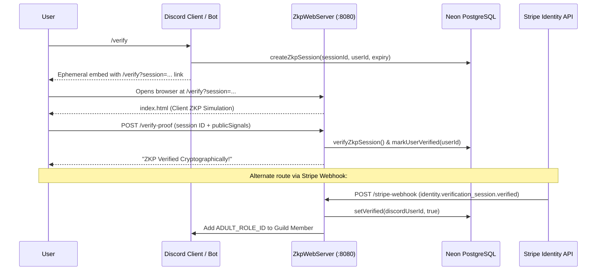
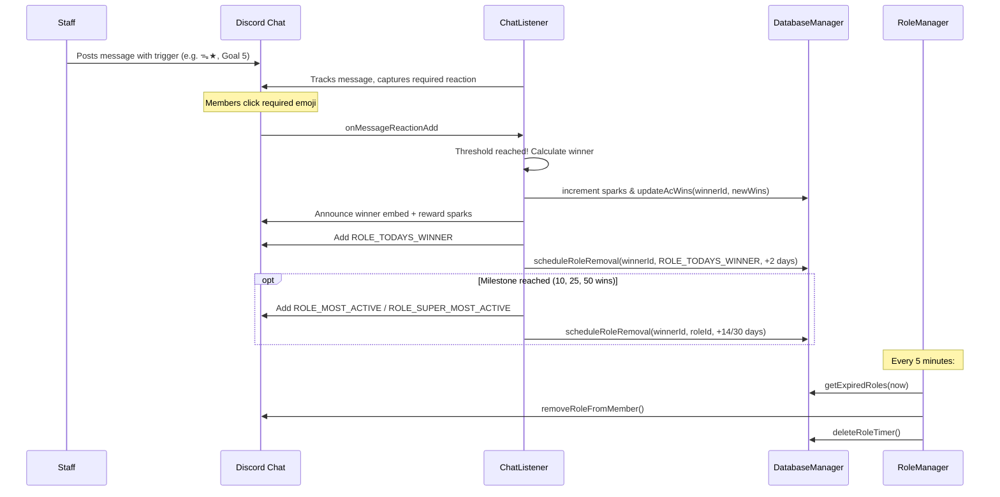

# AMORA Bot - Architecture & Codebase Checkpoints

> **Fast Context Restoration Document**  
> Read this file first when opening this project in a new session. It contains the complete architectural blueprint, class breakdown, database schema, environment variables, workflows, and extension points.

---

## 1. Project High-Level Overview

- **Name**: AMORA Bot (`com.amore:amore-bot:1.0-SNAPSHOT`)
- **Primary Function**: Multi-functional community, economy, marketplace, staff governance, event synchronization, and zero-knowledge age verification Discord bot for the AMORA community.
- **Language / Runtime**: Java 17 (Eclipse Temurin)
- **Build System**: Apache Maven (`pom.xml` with `maven-shade-plugin` packaging `app.jar` with `com.amore.App` as Main-Class)
- **Deployment**: Docker container (`Dockerfile` multistage build from `maven:3.9.8-eclipse-temurin-17` to `eclipse-temurin:17-jre`), hosted on Render/Cloud.
- **Discord Framework**: JDA (`net.dv8tion:JDA:5.0.0-beta.24`) with `MESSAGE_CONTENT` gateway intent enabled.
- **Database**: Neon PostgreSQL via `org.postgresql:postgresql:42.7.3` (`DATABASE_URL`), connection health recovery with `ensureConnected()`.
- **Web / Verification**: Embedded HTTP server (`com.sun.net.httpserver.HttpServer`) on port `PORT` (default 8080) hosting ZKP verification and Stripe Webhooks.

---

## 2. Directory & Source Layout

```
D:/Discord/amora-bot/
├── pom.xml                               # Maven project definition, dependencies, shade plugin
├── Dockerfile                            # Multi-stage container build definition
├── README.md                             # Base readme
├── CHECKPOINTS.md                        # THIS FILE: Primary context and architecture map
└── src/
    ├── main/
    │   ├── resources/
    │   │   └── index.html                # Client-side Zero-Knowledge proof simulation page
    │   └── java/com/amore/
    │       ├── App.java                  # Main entry point, JDA startup, slash command registration, song cron
    │       ├── DatabaseManager.java      # Singleton DB manager, Neon Postgres reconnection, schema DDL, CRUD
    │       ├── CommandListener.java      # Slash commands, context menus, modals, entity/string selects, shops
    │       ├── ChatListener.java         # Messages, active check minigames, spark drops, stress engine, hunter grid
    │       ├── AnnouncementListener.java # Event sync, reaction-based RSVP party roster, reminder schedulers
    │       ├── ActivityMonitor.java      # 12h scheduler: monthly rank tasks, 30-day activity sweeps, daily duties
    │       ├── LoungeManager.java        # 2h periodic quote drop in lounge, auto-deletes prior quote message
    │       ├── StatusRotator.java        # 5m periodic rich presence rotator
    │       ├── RoleManager.java          # 5m periodic expired temporary role revocation sweep
    │       ├── StripeService.java        # Stripe Identity API client for document/selfie verification
    │       ├── ZkpWebServer.java         # Embedded HTTP server: /verify, /verify-proof, /stripe-webhook
    │       └── YouTubePlaylistImporter.java # YouTube Data API v3 playlist scraper & song parser
    └── test/                             # Test root (currently empty)
```

---

## 3. Class-by-Class Architecture & Responsibilities

### 3.1 `App.java` (Application Bootstrap & Command Registry)
- **Entry point**: `App.main(String[] args)`.
- Validates `DISCORD_TOKEN`, initializes `DatabaseManager` and runs `db.cleanupExpiredSessions()`.
- Builds JDA instance with `GatewayIntent.MESSAGE_CONTENT`, attaches 3 primary event listeners:
  - `new CommandListener()`
  - `new ChatListener()`
  - `new AnnouncementListener()`
- Awaits JDA ready state, then starts background services:
  - `StatusRotator.start(jda)` (5-minute status rotation)
  - `LoungeManager.start(jda)` (2-hour lounge quote cycle)
  - `RoleManager.start(jda)` (5-minute role expiration sweep)
  - `ActivityMonitor.start(jda)` (12-hour activity and rank scheduler)
  - `ZkpWebServer.startServer(webPort, jda)` (HTTP server for ZKP & Stripe)
- Registers all Slash Commands & Context Menu commands with Discord:
  - Slash: `/forcesweep`, `/syncschedule`, `/taskbank`, `/toggleapps`, `/amorahub`, `/help`, `/serverreport`, `/rolepanel`, `/agepanel`, `/verify`, `/unverify`, `/gift`, `/eventsetup`, `/pull`, `/balance`, `/inventory`, `/forge`, `/transcript`, `/leaderboard`, `/shop evaluate`, `/addsparks`, `/award`, `/trade`, `/payout`, `/publish`, `/activitycheck`, `/profile`, `/song [add|importplaylist|remove|list|suggest|postnow]`.
  - Context Menu: `🛒 Order This` (Message Context Command).
- **Daily Song Scheduler**: `startDailySongScheduler(jda)` runs every 60s, checking if UTC hour >= `DAILY_SONG_POST_HOUR_UTC`. If not posted today (`daily_song_last_post_date` in `bot_state`), picks a community song from `song_suggestions`, fetches artwork, embeds it in `DAILY_SONG_CHANNEL_ID`, and alerts `LOUNGE_CHANNEL_ID`.

### 3.2 `DatabaseManager.java` (Database Engine & Schema Migration)
- **Connection**: Managed via JDBC connection string `DATABASE_URL` (specifically tuned for serverless PostgreSQL on Neon).
- **Auto-Reconnection**: Every query calls `ensureConnected()` to recover from idle disconnects or dropped connections (`connection.isValid(2)`).
- **Database Tables Managed**:
  1. `users`: Stores user ID, Sparks, Points, comma-separated inventory, gacha pity counter, bounties cleared, urgent bounties cleared, active check wins (`ac_wins`), strikes (`activity_strikes`), compensation flag (`is_comp`), and `last_task_date`.
  2. `shop_items`: Secret links mapped to asset names.
  3. `user_verifications`: Verification flag and timestamp.
  4. `zkp_sessions`: Active verification sessions with expiration timestamps.
  5. `pending_trade_setups`: Staging trades during item selection before proposal.
  6. `active_trades`: Proposed trades waiting for recipient action.
  7. `pending_forges`: Staged items for craft/recycle synthesis.
  8. `song_suggestions`: Pool of suggested songs with title, artist, link, source, active status, creation time, and last featured timestamp.
  9. `bot_state`: Key-value state store for timestamps (e.g. `last_task_drop`, `last_activity_sweep`, `last_quote_msg_id`, `daily_song_last_post_date`, `global_commands_used`).
  10. `role_timers`: Temporary roles scheduled for removal `(user_id, role_id, expires_at)`.
  11. `creator_stats`: Monthly and all-time shop sales, items listed, total ratings, and total stars.
  12. `staff_stats`: Metrics for staff members (tickets, events hosted, payouts).
  13. `creator_prompts`: Tracks prompt messages in shop forum showcase threads.
  14. `task_bank`: Pool of monthly tasks divided by rank (`rank_target`, `content`).
  15. `event_sync`: Maps event schedule message IDs to thread IDs, RSVP emojis, and audiences.
  16. `staff_schedule`: Day of week (1–7) mapped to duty task names and assigned user IDs.

### 3.3 `CommandListener.java` (Commands, Interactions, Economy, Modals)
- Handles `onSlashCommandInteraction`, `onModalInteraction`, `onStringSelectInteraction`, `onEntitySelectInteraction`, `onButtonInteraction`, and `onMessageReceived`.
- **Economy & Gacha**:
  - `/pull`: Deducts 50 Sparks, calculates rarity rates, updates pity counter, adds pulled photocard/asset to user inventory in DB.
  - `/inventory`: Displays formatted inventory with rarity icons and item counts.
  - `/forge`: Interactive forge/recycle window using buttons to break down or combine items.
  - `/trade [target]`: Multi-step interactive trading UI using string select menus to select offered and requested items.
  - `/balance`: Displays current Sparks and Points.
- **Creator Marketplace & Orders**:
  - `/publish`: Posts assets to forum channels with delivery codes saved in `shop_items`.
  - Context menu `🛒 Order This`: Creates order ticket channels or threads, updates `creator_stats`.
  - `/shop evaluate [reset]`: Identifies sellers with 0 sales for compensation reports.
  - `/transcript`: Exports complete thread/channel transcripts for order records.
- **Governance & Verification**:
  - `/forcesweep`: Allows admins to dry-run or force-fire monthly task drops or activity sweeps.
  - `/taskbank`: Adds tasks to the randomized monthly bank for ranks (Flare, Spark, Neon, Pulse, Prism, Supernova).
  - `/toggleapps`: Opens/closes applications modal UI.
  - `/amorahub`: Director dashboard with interactive buttons for applications (Member, Seller, Staff).
  - `/verify` & `/unverify`: Generates single-use ZKP session links pointing to the web server portal.
- **M.IKU Stress System**:
  - `/gift`: Allows members to gift matcha, plushies, spa vouchers, or energy drinks to reduce M.IKU's stress level.

### 3.4 `ChatListener.java` (Chat Intelligence, Active Checks, Mini-Games)
- **Active Checks**:
  - Detects messages formatted with triggers (e.g. `ᯓ★`, react phrase, goal phrase).
  - Tracks reactions on active check messages. When the goal is reached, awards Sparks, logs the win, increments `ac_wins`, and assigns tiered trophy roles:
    - Daily Winner: `ROLE_TODAYS_WINNER` (2-day temporary timer)
    - 10 Wins: `ROLE_MOST_ACTIVE` (14-day timer)
    - 25 Wins: `ROLE_SUPER_MOST_ACTIVE` (30-day timer)
    - 50 Wins: `ROLE_FRENZY_KILLER` (permanent or long-term)
- **Chat Minigames**:
  - **Hunter Grid (`GridState`)**: 5x5 ASCII grid game where player navigates 🍵 away from the hunter 💀 toward sparks ✨.
  - **Pet Mascot (`PetState`)**: Interactive pet with fullness, happiness, and cravings (food 🍓, toy 🧸, headpats ✋).
  - **Random Spark Drops**: Periodically drops clickable buttons in chat allowing fastest users to claim free Sparks.
- **M.IKU Mood & AI Triggers**:
  - Dynamic stress tracking; triggers contextual replies, emotes, and reactions based on chat sentiment.

### 3.5 `AnnouncementListener.java` (Events, Schedules, RSVP Synchronization)
- Handles `onMessageReactionAdd`, `onMessageReactionRemove`, `onButtonInteraction`, and select menus for events.
- **Event Synchronization**:
  - Links schedule announcements to discussion threads via `event_sync` table.
  - When members react or click RSVP buttons, checks audience permissions (`MEMBER_ROLE_ID`), dynamically edits the announcement embed to update the party list `👥 Party (X/Y)`, and handles overflow/waiting lists.
- **Event Scheduling**:
  - Uses `EVENT_SCHEDULER` to set timers triggering reminder pings (15 minutes prior and at event start) in designated channels (`SCHEDULE_CHANNEL_ID`, `MEMBER_SCHEDULE_CHANNEL_ID`, `LOUNGE_CHANNEL_ID`).

### 3.6 `ActivityMonitor.java` (Automated Rank Governance & Quotas)
- Runs every 12 hours via single-thread executor.
- **Day 1 Tasks Drop**:
  - Selects a random task from `task_bank` for each rank (`Flare`, `Spark`, `Neon`, `Pulse`, `Prism`, `Supernova`) and broadcasts to corresponding `<RANK>_CHANNEL_ID`.
- **Day 1 Activity Sweep**:
  - Scans all guild members holding official rank roles.
  - Excludes bots and members with `HIATUS_ROLE_ID`.
  - If a member has not completed a task in 30 days (`last_task_date`), increments `activity_strikes`:
    - Strike 1: Warning DM sent.
    - Strike 2: Rank decay / demotion warning DM sent.
    - Strike 3: Rank removal notice sent.
  - If member completed a task, resets strikes to 0.
- **Mid-Month (Day 15) & Final (Day 25) Reminders**: Sends warning alerts to `TASK_CHANNEL_ID`.
- **Daily Staff Duty Ping (Hour >= 1 UTC)**: Checks `staff_schedule` for current day of week and tags assigned staff members in `STAFF_SCHEDULE_CHANNEL_ID`.

### 3.7 `RoleManager.java` (Temporary Role Timer Engine)
- Runs every 5 minutes.
- Queries `role_timers` for `expires_at <= currentTimeMillis`.
- Removes the expired role from the Discord member and deletes the timer entry from the database.

### 3.8 `StatusRotator.java` (Bot Presence)
- Runs every 5 minutes.
- Cycles through a curated list of aesthetic playing statuses (e.g. `AMORA ✦: Matcha Says to Type /pull`, `Dropping Sparks in chat ✨`, etc.).

### 3.9 `LoungeManager.java` (Lounge Automations)
- Runs every 2 hours.
- Selects a quote from `QUOTES`, deletes the previous quote message (using message ID saved in `bot_state.last_quote_msg_id`), and posts the new quote embed in `LOUNGE_CHANNEL_ID`.

### 3.10 `ZkpWebServer.java` & `src/main/resources/index.html` (Web Endpoints)
- Starts embedded `HttpServer` on port `PORT` backed by a multi-threaded fixed thread pool (`Executors.newFixedThreadPool(4)`):
  - `GET /verify?session=<ID>`: Serves `index.html` for client-side cryptographic proof generation simulation.
  - `POST /verify-proof`: Validates session ID, marks user verified in DB, strips `minorRole` if present, and automatically assigns `ADULT_ROLE_ID`.
  - `POST /stripe-webhook`: Verifies Stripe webhook cryptographic signature (when `STRIPE_WEBHOOK_SECRET` is set), processes `identity.verification_session.verified`, marks user verified in DB, and grants `ADULT_ROLE_ID`.
### 3.11 `StripeService.java`
- Wraps Stripe Identity API (`com.stripe:stripe-java`).
- `createVerificationSession(String discordUserId)`: Creates a Stripe VerificationSession requiring document and selfie match, embedding the `discord_user_id` in metadata.

### 3.12 `YouTubePlaylistImporter.java`
- Uses YouTube Data API v3 (`YOUTUBE_API_KEY`) to fetch playlist items, parse video titles and channel names into `ImportedSong(title, artist, link)`, supporting batch song pool imports.

---

## 4. Complete Environment Variables Specification

| Variable | Description | Used In |
|---|---|---|
| `DISCORD_TOKEN` | Discord Bot application secret token | `App.java` |
| `DATABASE_URL` | PostgreSQL connection URI (Neon PostgreSQL) | `DatabaseManager.java` |
| `PORT` | Port for embedded HTTP web server (default 8080) | `App.java`, `ZkpWebServer.java` |
| `DAILY_SONG_CHANNEL_ID` | Channel where daily songs are recommended | `App.java`, `CommandListener.java` |
| `DAILY_SONG_POST_HOUR_UTC` | UTC hour (0–23) to trigger daily song post | `App.java` |
| `LOUNGE_CHANNEL_ID` | Main community lounge channel (quotes & music pings) | `App.java`, `LoungeManager.java`, `AnnouncementListener.java` |
| `TASK_CHANNEL_ID` | Channel for mid-month and final rank task reminders | `ActivityMonitor.java` |
| `STAFF_SCHEDULE_CHANNEL_ID` | Channel where daily staff duties are announced | `ActivityMonitor.java` |
| `HIATUS_ROLE_ID` | Role ID exempting members from monthly activity sweeps | `ActivityMonitor.java`, `CommandListener.java` |
| `SCHEDULE_CHANNEL_ID` | Channel for public event schedule reminders | `AnnouncementListener.java`, `ChatListener.java` |
| `MEMBER_SCHEDULE_CHANNEL_ID` | Channel for official member event schedules | `AnnouncementListener.java` |
| `MEMBER_CHAT_CHANNEL_ID` | Official members text chat channel | `AnnouncementListener.java` |
| `CHAT_ACTIVITY_CHANNEL_ID` | General activity channel for minigames & drops | `ChatListener.java` |
| `ACTIVE_CHECK_CHANNEL_ID` | Channel monitored for active check reactions | `ChatListener.java` |
| `ORDER_CHANNEL_ID` | Channel designated for marketplace orders | `CommandListener.java` |
| `SHOP_FORUM_CHANNEL_ID` | Primary forum channel for creator shop assets | `CommandListener.java`, `ChatListener.java` |
| `SHOP_FORUM_CHANNEL_ID_2` | Secondary forum channel for creator shop assets | `ChatListener.java` |
| `SHOP_LOG_CHANNEL_ID` | Audit log channel for shop sales and listings | `CommandListener.java` |
| `AUDIT_LOG_CHANNEL_ID` | General administrative audit log channel | `CommandListener.java` |
| `ROLE_LOG_CHANNEL_ID` | Audit log channel for role assignment actions | `CommandListener.java` |
| `MEMBER_APP_CATEGORY_ID` | Category ID where member & staff application tickets spawn | `CommandListener.java` |
| `SELLER_APP_CATEGORY_ID` | Category ID where seller application tickets spawn | `CommandListener.java` |
| `MINOR_CHANNEL_ID` | Minor channel ID (routed via age selection panel) | `CommandListener.java` |
| `ADULT_CHANNEL_ID` | 18+ channel ID (routed via age selection panel) | `CommandListener.java` |
| `ADULT_ROLE_ID` | 18+ verified role ID (assigned on ZKP/Stripe success) | `ZkpWebServer.java`, `CommandListener.java` |
| `MEMBER_ROLE_ID` | Official Member role ID | `AnnouncementListener.java`, `CommandListener.java` |
| `AMORIX_ROLE_ID` | AMORIX sub-team role ID | `AnnouncementListener.java`, `CommandListener.java` |
| `AMORA_ROLE_ID` | Explicit AMORA Official Member role ID override | `CommandListener.java` |
| `TRAINEE_ROLE_ID` / `TRAINEE_ROLE_IDS` | Trainee role ID(s) | `CommandListener.java` |
| `GUEST_ROLE_ID` / `VISITOR_ROLE_ID` | Guest / Visitor role ID | `AnnouncementListener.java`, `CommandListener.java` |
| `TICKET_CHANNEL_ID` | Fallback ticket channel ID for help / member inquiries | `CommandListener.java` |
| `HIATUS_CHANNEL_ID` | Channel ID for Hiatus / LOA logging requests | `CommandListener.java` |
| `HR_ROLE_ID` | HR Staff role ID (applications toggle) | `CommandListener.java` |
| `HIGH_STAFF_ROLE_IDS` | Comma-separated role IDs with high staff clearances | `AnnouncementListener.java`, `CommandListener.java` |
| `ADDSPARKS_ROLE_IDS` | Comma-separated role IDs authorized for `/addsparks` | `CommandListener.java` |
| `PAYOUT_ROLE_IDS` | Comma-separated role IDs authorized for `/payout` | `CommandListener.java` |
| `MUSIC_ADMIN_ROLE_IDS` | Comma-separated role IDs authorized for music management | `CommandListener.java` |
| `ROLE_TODAYS_WINNER` | Temporary 2-day role for active check winner | `ChatListener.java` |
| `ROLE_MOST_ACTIVE` | Temporary 14-day role for 10 active check wins | `ChatListener.java` |
| `ROLE_SUPER_MOST_ACTIVE` | Temporary 30-day role for 25 active check wins | `ChatListener.java` |
| `ROLE_FRENZY_KILLER` | Trophy role for 50 active check wins | `ChatListener.java` |
| `FLARE_CHANNEL_ID` | Channel for Flare rank task drops | `ActivityMonitor.java`, `CommandListener.java` |
| `SPARK_CHANNEL_ID` | Channel for Spark rank task drops | `ActivityMonitor.java`, `CommandListener.java` |
| `NEON_CHANNEL_ID` | Channel for Neon rank task drops | `ActivityMonitor.java`, `CommandListener.java` |
| `PULSE_CHANNEL_ID` | Channel for Pulse rank task drops | `ActivityMonitor.java`, `CommandListener.java` |
| `PRISM_CHANNEL_ID` | Channel for Prism rank task drops | `ActivityMonitor.java`, `CommandListener.java` |
| `SUPERNOVA_CHANNEL_ID` | Channel for Supernova rank task drops | `ActivityMonitor.java`, `CommandListener.java` |
| `PING_OUTFITS` | Creator ping role ID for outfit assets | `ChatListener.java` |
| `PING_LYRICS` | Creator ping role ID for lyric assets | `ChatListener.java` |
| `PING_FACES` | Creator ping role ID for face assets | `ChatListener.java` |
| `PING_BUILDS` | Creator ping role ID for build assets | `ChatListener.java` |
| `STRIPE_SECRET_KEY` / `STRIPE_API_KEY` | Stripe API Secret Key for Identity verification | `StripeService.java` |
| `YOUTUBE_API_KEY` | Google / YouTube Data API v3 key | `YouTubePlaylistImporter.java` |
| `BASE_WEB_URL` | Base public URL of the bot (e.g. `https://amora-bot.onrender.com`) for ZKP verification links | `CommandListener.java` |
| `STRIPE_WEBHOOK_SECRET` | Secret key used to verify incoming Stripe webhook signatures | `ZkpWebServer.java` |

---

## 5. Key Workflows & Operational Lifecycles

### 5.1 Verification Flow (Zero-Knowledge & Stripe)


### 5.2 Active Check Minigame & Role Ladder Flow


### 5.3 Monthly Governance & Quota Flow
1. **Day 1**:
   - `ActivityMonitor` queries `task_bank` for each rank (`Flare` through `Supernova`) and drops a random task into rank channels.
   - Evaluates all members with official ranks. If `last_task_date` is older than 30 days and user is not on hiatus (`HIATUS_ROLE_ID`), increments `activity_strikes`:
     - Strike 1: Warning notification.
     - Strike 2: Demotion flag.
     - Strike 3: Suspension / official rank revocation.
2. **Day 15**: Broadcasts mid-month task reminder to `TASK_CHANNEL_ID`.
3. **Day 25**: Broadcasts final warning reminder to `TASK_CHANNEL_ID`.
4. **Daily**: Pings assigned staff in `STAFF_SCHEDULE_CHANNEL_ID` for daily duties configured in `staff_schedule`.

---

## 6. How to Build, Test, and Run

- **Build Fat JAR**:
  ```bash
  mvn clean package -DskipTests
  ```
  Produces `target/amore-bot-1.0-SNAPSHOT.jar`.
- **Run Locally**:
  ```bash
  java -jar target/amore-bot-1.0-SNAPSHOT.jar
  ```
- **Docker Container Build**:
  ```bash
  docker build -t amora-bot .
  docker run --env-file .env -p 8080:8080 amora-bot
  ```

---

## 7. Developer Notes & Gotchas

1. **PostgreSQL on Neon Idle Sleeping**: Neon compute instances auto-suspend after inactivity. Never hold long-lived raw JDBC connections open without pinging. Always use `DatabaseManager.getInstance().ensureConnected()` which checks `connection.isValid(2)` before queries.
2. **Application IDs & Modals**: Modals in `CommandListener` have strict ID prefixes (`member_app_modal`, `seller_app_modal`, `staff_app_modal`, `modal_taskbank_`). Any new modal must register its prefix in `CommandListener.onModalInteraction` or `AnnouncementListener.onModalInteraction`.
3. **Event Reminders Memory State**: `AnnouncementListener.activeTimers` is an in-memory `ConcurrentHashMap`. Restarting the bot clears scheduled futures for pending event notifications.
4. **Temporary Roles**: Temporary roles are safely persisted in `role_timers` in PostgreSQL, so bot restarts will not lose track of pending role revocations.
5. **No Direct `sed` or String Overwrites**: When editing `CommandListener.java` or `DatabaseManager.java`, remember they are large files (~3000-5000 lines); always read the target lines first to obtain fresh anchor tags.
