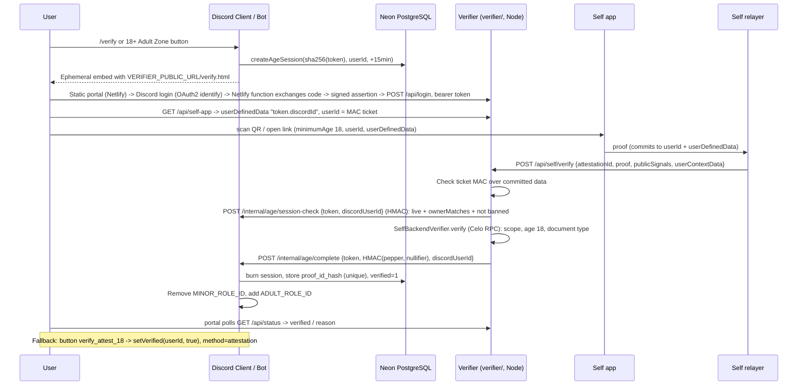
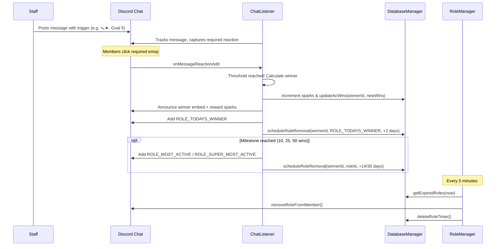

# AMORA Bot - Architecture & Codebase Checkpoints

> **Fast Context Restoration Document**  
> Read this file first when opening this project in a new session. It contains the complete architectural blueprint, class breakdown, database schema, environment variables, workflows, and extension points.

---

## 1. Project High-Level Overview

- **Name**: AMORA Bot (`com.amore:amore-bot:1.0-SNAPSHOT`)
- **Primary Function**: Multi-functional community, economy, marketplace, staff governance, event synchronization, and zero-knowledge (Self) 18+ age gate Discord bot for the AMORA community.
- **Language / Runtime**: Java 17 (Eclipse Temurin)
- **Build System**: Apache Maven (`pom.xml` with `maven-shade-plugin` packaging `app.jar` with `com.amore.App` as Main-Class)
- **Deployment**: Docker container (`Dockerfile` multistage build from `maven:3.9.8-eclipse-temurin-17` to `eclipse-temurin:17-jre`), hosted on Render/Cloud.
- **Discord Framework**: JDA (`net.dv8tion:JDA:5.0.0-beta.24`) with `MESSAGE_CONTENT` gateway intent enabled.
- **Database**: Neon PostgreSQL via `org.postgresql:postgresql:42.7.3` (`DATABASE_URL`), connection health recovery with `ensureConnected()`.
- **Web / Verification**: Embedded HTTP server (`com.sun.net.httpserver.HttpServer`) on port `PORT` (default 8080) for the internal verifier API; zero-knowledge age proofs are verified by the separate `verifier/` service.

---

## 2. Directory & Source Layout

```
D:/Discord/amora-bot/
├── pom.xml                               # Maven project definition, dependencies, shade plugin
├── Dockerfile                            # Multi-stage container build definition
├── README.md                             # Base readme
├── CHECKPOINTS.md                        # THIS FILE: Primary context and architecture map
└── src/
    ├── main/
    │   ├── resources/
    │   │   └── music/kpop_starter_pack.tsv  # Curated K-pop classics + recent hits, seeded once into the song pool
    │   └── java/com/amore/
    │       ├── App.java                  # Main entry point, JDA startup, slash command registration
    │       ├── DatabaseManager.java      # Singleton DB manager, Neon Postgres reconnection, schema DDL, CRUD
    │       ├── CommandListener.java      # Slash commands, context menus, modals, entity/string selects, shops
    │       ├── ChatListener.java         # Messages, active check minigames, spark drops, stress engine, hunter grid
    │       ├── AnnouncementListener.java # Event sync, reaction-based RSVP party roster, reminder schedulers
    │       ├── ActivityMonitor.java      # 12h scheduler: monthly rank tasks, 30-day activity sweeps, daily duties
    │       ├── LoungeManager.java        # 2h periodic quote drop in lounge, auto-deletes prior quote message
    │       ├── GameSpotlight.java        # BubbleGum Dance Studio promo: 6h self-replacing lounge drop, /game
    │       ├── ProfileCard.java          # Active Check shoutout card renderer (PNG)
    │       ├── StatusRotator.java        # 5m periodic rich presence rotator
    │       ├── RoleManager.java          # 5m periodic expired temporary role revocation sweep
    │       ├── InternalApiServer.java    # Embedded HTTP server: /health, /internal/age/*
    │       ├── YouTubePlaylistImporter.java # YouTube Data API v3 playlist import & view counts
    │       ├── SongMetadata.java         # Song link/title/artist normalization, answer matching, tags
    │       ├── MusicListener.java        # /song, /music, music buttons/modals/chat guesses
    │       ├── MusicService.java         # Song of the Day loop, votes, streaks, vinyls, sponsors, recap
    │       ├── MusicGames.java           # Who Added It?, Blurred Cover, Songdle, Higher or Lower
    │       ├── MusicBattle.java          # Weekly song bracket
    │       ├── MusicRepository.java      # Music persistence + migrations
    │       └── MusicArt.java             # Artwork lookup, pixelation, recap card
    └── test/                             # Test root (currently empty)
```

---

## 3. Class-by-Class Architecture & Responsibilities

### 3.1 `App.java` (Application Bootstrap & Command Registry)
- **Entry point**: `App.main(String[] args)`.
- Validates `DISCORD_TOKEN`, initializes `DatabaseManager` and runs `db.cleanupExpiredSessions()`.
- Builds JDA instance with `GatewayIntent.MESSAGE_CONTENT`, attaches 5 primary event listeners:
  - `new CommandListener()`
  - `new ChatListener()`
  - `new AnnouncementListener()`
  - `new MusicListener()`
  - `new GameSpotlight()`
- Awaits JDA ready state, then starts background services:
  - `StatusRotator.start(jda)` (5-minute status rotation)
  - `LoungeManager.start(jda)` (2-hour lounge quote cycle)
  - `GameSpotlight.start(jda)` (6-hour game spotlight cycle, offset +1h from quotes)
  - `RoleManager.start(jda)` (5-minute role expiration sweep)
  - `ActivityMonitor.start(jda)` (12-hour activity and rank scheduler)
  - `InternalApiServer.startServer(webPort, jda)` (HTTP server for the verifier callbacks)
- Registers all Slash Commands & Context Menu commands with Discord:
  - Slash: `/forcesweep`, `/syncschedule`, `/taskbank`, `/toggleapps`, `/amorahub`, `/help`, `/serverreport`, `/rolepanel`, `/agepanel`, `/verify`, `/unverify`, `/ageban [add|remove|list]`, `/gift`, `/eventsetup`, `/pull`, `/balance`, `/inventory`, `/forge`, `/transcript`, `/leaderboard`, `/shop evaluate`, `/addsparks`, `/award`, `/trade`, `/payout`, `/publish`, `/activitycheck`, `/profile`, plus `MusicListener.commands()` (`/song`, `/music`).
  - Context Menu: `🛒 Order This` (Message Context Command).
- **Music**: `MusicService.start(jda)` runs the music scheduler (daily song, settlement, weekly battle, monthly recap). See 3.13 and 5.4.

### 3.2 `DatabaseManager.java` (Database Engine & Schema Migration)
- **Connection**: Managed via JDBC connection string `DATABASE_URL` (specifically tuned for serverless PostgreSQL on Neon).
- **Auto-Reconnection**: Every query calls `ensureConnected()` to recover from idle disconnects or dropped connections (`connection.isValid(2)`).
- **Database Tables Managed**:
  1. `users`: Stores user ID, Sparks, Points, comma-separated inventory, gacha pity counter, bounties cleared, urgent bounties cleared, active check wins (`ac_wins`), strikes (`activity_strikes`), compensation flag (`is_comp`), and `last_task_date`.
  2. `shop_items`: Secret links mapped to asset names.
  3. `user_verifications`: Verification flag, timestamp, `method` (`attestation`/`self`; rows from before the provider switch keep `zkpassport`) and `proof_id_hash` (unique, one-way HMAC fingerprint of the Self nullifier; older rows hold zkPassport fingerprints that cannot be matched against Self). Plus `age_sessions` (SHA-256 of single-use token, owner user, expiry, used_at) and `age_bans` (user, reason, staff, time, banned `proof_id_hash`).
  4. `pending_trade_setups`: Staging trades during item selection before proposal.
  5. `active_trades`: Proposed trades waiting for recipient action.
  6. `pending_forges`: Staged items for craft/recycle synthesis.
  7. `song_suggestions`: Pool of songs: raw title/artist/link/source, `display_title`/`display_artist`, `dedupe_key`, `tags` (`,a,b,`), `origin` (`member`/`import`), cached YouTube `view_count`, active flag, timestamps. Music tables (owned by `MusicRepository`): `song_features`, `song_votes`, `song_listens`, `song_thread_rewards`, `user_music_stats`, `song_sponsors`, `user_vinyls`, `songdle_plays`, `song_battles`, `battle_matches`, `battle_votes`.
  8. `bot_state`: Key-value state store for timestamps (e.g. `last_task_drop`, `last_activity_sweep`, `last_quote_msg_id`, `last_game_spotlight_msg_id`, `daily_song_last_post_date`, `global_commands_used`).
  9. `role_timers`: Temporary roles scheduled for removal `(user_id, role_id, expires_at)`.
  10. `creator_stats`: Monthly and all-time shop sales, items listed, total ratings, and total stars.
  11. `staff_stats`: Metrics for staff members (tickets, events hosted, payouts).
  12. `creator_prompts`: Tracks prompt messages in shop forum showcase threads.
  13. `task_bank`: Pool of monthly tasks divided by rank (`rank_target`, `content`).
  14. `event_sync`: Maps event schedule message IDs to thread IDs, RSVP emojis, and audiences.
  15. `staff_schedule`: Day of week (1-7) mapped to duty task names and assigned user IDs.

### 3.3 `CommandListener.java` (Commands, Interactions, Economy, Modals)
- Handles `onSlashCommandInteraction`, `onModalInteraction`, `onStringSelectInteraction`, `onEntitySelectInteraction`, `onButtonInteraction`, and `onMessageReceived`.
- **Economy & Gacha**:
  - `/pull`: Deducts 50 Sparks, calculates rarity rates, updates pity counter, adds pulled photocard/asset to user inventory in DB.
  - `/inventory`: Displays formatted inventory with rarity icons and item counts.
  - `/forge`: Interactive forge/recycle window using buttons to break down or combine items.
  - `/trade [target]`: Multi-step interactive trading UI using string select menus to select offered and requested items.
  - `/balance`: Displays current Sparks and Points.
- **Creator Marketplace & Orders**:
  - `/publish`: Posts assets to forum channels with delivery codes saved in `shop_items`.
  - Context menu `🛒 Order This`: Creates order ticket channels or threads, updates `creator_stats`.
  - `/shop evaluate [reset]`: Identifies sellers with 0 sales for compensation reports.
  - `/transcript`: Exports complete thread/channel transcripts for order records.
- **Governance & Verification**:
  - `/forcesweep`: Allows admins to dry-run or force-fire monthly task drops or activity sweeps.
  - `/taskbank`: Adds tasks to the randomized monthly bank for ranks (Flare, Spark, Neon, Pulse, Prism, Supernova).
  - `/toggleapps`: Opens/closes applications modal UI.
  - `/amorahub`: Director dashboard with interactive buttons for applications (Member, Seller, Staff).
  - `/verify` & `/unverify`: `/verify` (and the 18+ panel button) creates a 15-minute single-use age session and shows a Self proof link (when `VERIFIER_PUBLIC_URL` is set) and/or a self-attestation button (unless `ALLOW_SELF_ATTESTATION=false`; Discord account age is not checked). `/unverify` resets the flag and clears the stored ID fingerprint so that ID can be used again.
- **M.IKU Stress System**:
  - `/gift`: Allows members to gift matcha, plushies, spa vouchers, or energy drinks to reduce M.IKU's stress level.
- `/profile` includes a 🎵 Music field; `/leaderboard` has a `curators` category. Both read from `MusicService` / `MusicRepository`.

### 3.4 `ChatListener.java` (Chat Intelligence, Active Checks, Mini-Games)
- **Active Checks**:
  - Detects messages formatted with triggers (e.g. `ᯓ★`, react phrase, goal phrase).
  - Tracks reactions on active check messages. When the goal is reached, awards Sparks, logs the win, increments `ac_wins`, and assigns tiered trophy roles:
    - Daily Winner: `ROLE_TODAYS_WINNER` (2-day temporary timer)
    - 10 Wins: `ROLE_MOST_ACTIVE` (14-day timer)
    - 25 Wins: `ROLE_SUPER_MOST_ACTIVE` (30-day timer)
    - 50 Wins: `ROLE_FRENZY_KILLER` (permanent or long-term)
- **Chat Minigames**:
  - **Hunter Maze Chase (`GridState`)**: 5x5 dungeon chase featuring player session locking, Stone Wall obstacles (`🧱`), Freeze Traps (`⚡`), Super Gems (`💎`), and Hunter AI with freeze recovery (`🧊`/`💀`).
  - **Lounge Mascot Care (`PetState`)**: 3 random mascot species (Matcha Bunny 🐰, Cinna Cloud Pup ☁️🐶, Neon Star Kitty 🐱✨) featuring Affection Heart Bars (`💖`/`🤍`) and Combo multipliers (`💖 Combo x1, x2, x3!`) granting bonus Sparks.
  - **Themed Tic-Tac-Toe (`TicTacToeState`)**: Aesthetic Matcha (`🍵`) vs Strawberry (`🍓`) pieces with stone obstacles (`🧱`), Solo AI (Minimax with alpha-beta pruning), PvP mode, and consolation Spark rewards on draws.
  - **Random Spark Drops**: Clickable buttons dropped in chat with in-memory message batching.
- **M.IKU Mood & AI Triggers**:
  - Dynamic stress tracking; triggers contextual replies, emotes, and reactions based on chat sentiment.

### 3.5 `AnnouncementListener.java` (Events, Schedules, RSVP Synchronization)
- Handles `onMessageReactionAdd`, `onMessageReactionRemove`, `onButtonInteraction`, and select menus for events.
- **Event Synchronization**:
  - Links schedule announcements to discussion threads via `event_sync` table.
  - When members react or click RSVP buttons, checks audience permissions (`MEMBER_ROLE_ID`), dynamically edits the announcement embed to update the party list `👥 Party (X/Y)`, and handles overflow/waiting lists.
- **Event Scheduling**:
  - Uses `EVENT_SCHEDULER` to set timers triggering reminder pings (15 minutes prior and at event start) in designated channels (`SCHEDULE_CHANNEL_ID`, `MEMBER_SCHEDULE_CHANNEL_ID`, `LOUNGE_CHANNEL_ID`).

### 3.6 `ActivityMonitor.java` (Automated Rank Governance & Quotas)
- Runs every 12 hours via single-thread executor.
- **Day 1 Tasks Drop**:
  - Selects a random task from `task_bank` for each rank (`Flare`, `Spark`, `Neon`, `Pulse`, `Prism`, `Supernova`) and broadcasts to corresponding `<RANK>_CHANNEL_ID`.
- **Day 1 Activity Sweep**:
  - Scans all guild members holding official rank roles.
  - Excludes bots and members with `HIATUS_ROLE_ID`.
  - If a member has not completed a task in 30 days (`last_task_date`), increments `activity_strikes`:
    - Strike 1: Warning DM sent.
    - Strike 2: Rank decay / demotion warning DM sent.
    - Strike 3: Rank removal notice sent.
  - If member completed a task, resets strikes to 0.
- **Mid-Month (Day 15) & Final (Day 25) Reminders**: Sends warning alerts to `TASK_CHANNEL_ID`.
- **Daily Staff Duty Ping (Hour >= 1 UTC)**: Checks `staff_schedule` for current day of week and tags assigned staff members in `STAFF_SCHEDULE_CHANNEL_ID`.

### 3.7 `RoleManager.java` (Temporary Role Timer Engine)
- Runs every 5 minutes.
- Queries `role_timers` for `expires_at <= currentTimeMillis`.
- Removes the expired role from the Discord member and deletes the timer entry from the database.

### 3.8 `StatusRotator.java` (Bot Presence)
- Runs every 5 minutes.
- Cycles through a curated list of aesthetic playing statuses (e.g. `AMORA ✦: Matcha Says to Type /pull`, `Dropping Sparks in chat ✨`, etc.).

### 3.9 `LoungeManager.java` (Lounge Automations)
- Runs every 2 hours.
- Selects a quote from `QUOTES`, deletes the previous quote message (using message ID saved in `bot_state.last_quote_msg_id`), and posts the new quote embed in `LOUNGE_CHANNEL_ID`.
- `GameSpotlight` (same pattern, promotes BubbleGum Dance Studio, a Roblox BETA by Owl `162989003405131776`): every 6h starting +1h after boot (quotes land on even hours, spotlights on odd). Skips the drop unless 15+ member messages arrived since the previous one (`bot_state.last_game_spotlight_msg_id`), then deletes it and posts a fresh embed with Roblox/Discord link buttons. `/game` posts the same embed on demand. The Roblox icon URL expires, so it is re-resolved from the thumbnails API every 12h. The status rotator also includes a line for the game.

### 3.10 `InternalApiServer.java` (Internal Endpoints)
- Starts embedded `HttpServer` on port `PORT` (`Executors.newFixedThreadPool(4)`):
  - `GET /health`.
  - `POST /internal/age/session-check`: HMAC-authenticated; reports whether a token's session is live (unused, unexpired). Does not consume it.
  - `POST /internal/age/complete`: HMAC-authenticated; atomically burns the session, stores the unique-ID fingerprint (one ID = one Discord account; 409 on reuse), marks the user verified, and swaps `MINOR_ROLE_ID` for `ADULT_ROLE_ID`.
- Auth: `X-Amora-Signature` = hex HMAC-SHA256(`VERIFIER_SHARED_SECRET`, `{X-Amora-Timestamp}.{rawBody}`), timestamp within 60s, 16 KiB body cap.

### 3.11 `verifier/` (zero-knowledge age verifier, Node 22)
- Separate service (own `Dockerfile`), JSON API only: `GET /config.json`, `GET /api/discord-url`, `POST /api/login` (takes the signed assertion from the Netlify login function), `GET /api/self-app` (bearer; QR parameters), `GET /api/status` (bearer; result of the scan), `POST /api/self/verify` (public; called by Self's relayer with the proof). CORS limited to the portal origin, bearer auth, no cookies. The user-facing portal is a static site (`verifier/site/`, built to `verifier/dist/site` and deployed on Netlify via the root `netlify.toml`, together with `verifier/netlify/functions/discord-login.mjs`, the only code that calls Discord because Render's shared IP is blocked by Cloudflare), so the Render API host is never opened in a browser tab (Google Safe Browsing was flagging it).
- Proofs come from the Self app (Self Pass SDK, `@selfxyz/core` `SelfBackendVerifier`, legacy but self-hosted). The QR commits `userDefinedData = "<token>.<discordUserId>"` and `userId = HMAC ticket` (UUID); the verifier only trusts the committed data when that MAC is valid, checks the session with the bot, verifies on Celo via public RPC (age >= 18, passport or biometric ID card only), then reports `HMAC(pepper, nullifier)` to the bot's internal API.
- Stateless apart from a 15-minute in-memory result map for the portal's status poll: no database access; the bot owns sessions, bans and roles. Requires `SITE_URL`, `API_PUBLIC_URL` (proofs are bound to its host and to `ZK_SCOPE`) and `DISCORD_CLIENT_ID` (Discord OAuth2 "identify" login; redirect URI `SITE_URL/verify.html`; the client secret is only on Netlify), so only the Discord account that owns a session can obtain a QR the verifier accepts.

### 3.12 `YouTubePlaylistImporter.java`
- Uses YouTube Data API v3 (`YOUTUBE_API_KEY`): `importPlaylist` returns raw `ImportedSong(title, channel, link)` items; `fetchViewCounts` batches `videos.list` statistics for Higher or Lower.

### 3.13 Music module (`Music*.java`, `SongMetadata.java`)
- `MusicListener`: owns `/song [add|importplaylist|remove|tag|list|suggest|postnow]` and `/music [help|songdle|game|vinyls|crate|sponsor|stats|match|battle|recap]`, plus every `music:` button and the `music:sdm` modal. It also routes chat messages to Blurred Cover guesses and Song of the Day thread rewards. `/music help` is the member guide (staff also see a staff section); `/help` links to it.
- `MusicService`: 60s scheduler (daily post, settlement, battle tick, monthly recap); voting, listening streaks, vinyls, sponsorships (150 Sparks, one pending, 7-day cooldown, refunded if the song is removed), crates (40 Sparks, duplicates refund 10), music twin, profile field.
- `MusicGames`: Who Added It? (public, 60s, +8), Blurred Cover (public, chat guesses, 4 sharpening stages, +15/10/6/3), Songdle (private daily puzzle, 6 guesses, +3 Sparks per unused guess), Higher or Lower (private, YouTube views, 3 rewarded runs a day, max +30). Who Added It? and Blurred Cover also appear in the random lounge games (`ChatListener.spawnRandomLoungeGame`).
- `MusicBattle`: weekly bracket (see 5.4).
- `MusicRepository`: all music SQL (record types `Song`, `Feature`, `Tally`, `Stats`, ...). It migrates `song_suggestions` on boot and backfills `origin` (rows sharing `(added_by, created_at)` are playlist imports) and the display metadata.
- `MusicArt`: cached oEmbed artwork lookup, pixelation, recap-card rendering.
- `SongMetadata`: link normalization, display-title/artist cleanup ("Artist - Title (Official Video)", "X - Topic", "XVEVO"), cross-source duplicate key, loose answer matching, tag vocabulary.
- Members may add 5 songs per 24h (staff unlimited); duplicates are rejected by link and by cleaned artist+title key.
- Bundled packs: `MusicRepository.seedPack` inserts `src/main/resources/music/kpop_starter_pack.tsv` (116 official K-pop uploads, classics plus 2023-2026 hits, tagged `kpop` plus mood/genre tags) once on boot as staff-playlist imports (`added_by = AMORA`), skipping songs already in the pool; guarded by `bot_state.music_seed_kpop_v1`. A new pack needs its own state key. `/song importplaylist` takes an optional `tags` option applied to every imported song.

---

## 4. Complete Environment Variables Specification

| Variable | Description | Used In |
|---|---|---|
| `DISCORD_TOKEN` | Discord Bot application secret token | `App.java` |
| `DATABASE_URL` | PostgreSQL connection URI (Neon PostgreSQL) | `DatabaseManager.java` |
| `PORT` | Port for embedded HTTP server (default 8080) | `App.java`, `InternalApiServer.java` |
| `DAILY_SONG_CHANNEL_ID` | Channel where daily songs, recaps (and battles by default) are posted | `MusicService.java`, `MusicBattle.java` |
| `DAILY_SONG_POST_HOUR_UTC` | UTC hour (0-23) to trigger the daily song post, weekly battle and monthly recap | `MusicService.java` |
| `LOUNGE_CHANNEL_ID` | Main community lounge channel (quotes & music pings) | `MusicService.java`, `LoungeManager.java`, `AnnouncementListener.java` |
| `TASK_CHANNEL_ID` | Channel for mid-month and final rank task reminders | `ActivityMonitor.java` |
| `STAFF_SCHEDULE_CHANNEL_ID` | Channel where daily staff duties are announced | `ActivityMonitor.java` |
| `HIATUS_ROLE_ID` | Role ID exempting members from monthly activity sweeps | `ActivityMonitor.java`, `CommandListener.java` |
| `SCHEDULE_CHANNEL_ID` | Channel for public event schedule reminders | `AnnouncementListener.java`, `ChatListener.java` |
| `MEMBER_SCHEDULE_CHANNEL_ID` | Channel for official member event schedules | `AnnouncementListener.java` |
| `MEMBER_CHAT_CHANNEL_ID` | Official members text chat channel | `AnnouncementListener.java` |
| `CHAT_ACTIVITY_CHANNEL_ID` | General activity channel for minigames & drops | `ChatListener.java` |
| `ACTIVE_CHECK_CHANNEL_ID` | Channel monitored for active check reactions | `ChatListener.java` |
| `ORDER_CHANNEL_ID` | Channel designated for marketplace orders | `CommandListener.java` |
| `SHOP_FORUM_CHANNEL_ID` | Primary forum channel for creator shop assets | `CommandListener.java`, `ChatListener.java` |
| `SHOP_FORUM_CHANNEL_ID_2` | Secondary forum channel for creator shop assets | `ChatListener.java` |
| `SHOP_LOG_CHANNEL_ID` | Audit log channel for shop sales and listings | `CommandListener.java` |
| `AUDIT_LOG_CHANNEL_ID` | General administrative audit log channel | `CommandListener.java` |
| `ROLE_LOG_CHANNEL_ID` | Audit log channel for role assignment actions | `CommandListener.java` |
| `MEMBER_APP_CATEGORY_ID` | Category ID where member & staff application tickets spawn | `CommandListener.java` |
| `SELLER_APP_CATEGORY_ID` | Category ID where seller application tickets spawn | `CommandListener.java` |
| `MINOR_CHANNEL_ID` | Minor channel ID (routed via age selection panel) | `CommandListener.java` |
| `ADULT_CHANNEL_ID` | 18+ channel ID (routed via age selection panel) | `CommandListener.java` |
| `ADULT_ROLE_ID` | 18+ verified role ID (assigned on ZK proof or attestation) | `InternalApiServer.java`, `CommandListener.java` |
| `MEMBER_ROLE_ID` | Official Member role ID | `AnnouncementListener.java`, `CommandListener.java` |
| `AMORIX_ROLE_ID` | AMORIX sub-team role ID | `AnnouncementListener.java`, `CommandListener.java` |
| `AMORA_ROLE_ID` | Explicit AMORA Official Member role ID override | `CommandListener.java` |
| `TRAINEE_ROLE_ID` / `TRAINEE_ROLE_IDS` | Trainee role ID(s) | `CommandListener.java` |
| `GUEST_ROLE_ID` / `VISITOR_ROLE_ID` | Guest / Visitor role ID | `AnnouncementListener.java`, `CommandListener.java` |
| `TICKET_CHANNEL_ID` | Fallback ticket channel ID for help / member inquiries | `CommandListener.java` |
| `HIATUS_CHANNEL_ID` | Channel ID for Hiatus / LOA logging requests | `CommandListener.java` |
| `HR_ROLE_ID` | HR Staff role ID (applications toggle) | `CommandListener.java` |
| `HIGH_STAFF_ROLE_IDS` | Comma-separated role IDs with high staff clearances | `AnnouncementListener.java`, `CommandListener.java` |
| `ADDSPARKS_ROLE_IDS` | Comma-separated role IDs authorized for `/addsparks` | `CommandListener.java` |
| `PAYOUT_ROLE_IDS` | Comma-separated role IDs authorized for `/payout` | `CommandListener.java` |
| `MUSIC_ADMIN_ROLE_IDS` | Comma-separated role IDs authorized for music management | `MusicListener.java` |
| `ROLE_TODAYS_WINNER` | Temporary 2-day role for active check winner | `ChatListener.java` |
| `ROLE_MOST_ACTIVE` | Temporary 14-day role for 10 active check wins | `ChatListener.java` |
| `ROLE_SUPER_MOST_ACTIVE` | Temporary 30-day role for 25 active check wins | `ChatListener.java` |
| `ROLE_FRENZY_KILLER` | Trophy role for 50 active check wins | `ChatListener.java` |
| `FLARE_CHANNEL_ID` | Channel for Flare rank task drops | `ActivityMonitor.java`, `CommandListener.java` |
| `SPARK_CHANNEL_ID` | Channel for Spark rank task drops | `ActivityMonitor.java`, `CommandListener.java` |
| `NEON_CHANNEL_ID` | Channel for Neon rank task drops | `ActivityMonitor.java`, `CommandListener.java` |
| `PULSE_CHANNEL_ID` | Channel for Pulse rank task drops | `ActivityMonitor.java`, `CommandListener.java` |
| `PRISM_CHANNEL_ID` | Channel for Prism rank task drops | `ActivityMonitor.java`, `CommandListener.java` |
| `SUPERNOVA_CHANNEL_ID` | Channel for Supernova rank task drops | `ActivityMonitor.java`, `CommandListener.java` |
| `PING_OUTFITS` | Creator ping role ID for outfit assets | `ChatListener.java` |
| `PING_LYRICS` | Creator ping role ID for lyric assets | `ChatListener.java` |
| `PING_FACES` | Creator ping role ID for face assets | `ChatListener.java` |
| `PING_BUILDS` | Creator ping role ID for build assets | `ChatListener.java` |
| `VERIFIER_PUBLIC_URL` | Public base URL of the static portal on Netlify (e.g. `https://amora-verify.netlify.app`). Same value as the verifier's `SITE_URL`. Unset = ZK option hidden | `CommandListener.java` |
| `VERIFIER_SHARED_SECRET` | >= 32 chars; HMAC key shared by bot and verifier for `/internal/age/*`. Unset/short = endpoints disabled | `InternalApiServer.java`, `verifier/` |
| `ALLOW_SELF_ATTESTATION` | `false` disables the self-attestation button (default enabled) | `CommandListener.java` |
| `ZK_ALLOW_DEV_PROOFS` | `true` lets the bot accept Self mock-passport (dev-mode) proofs. Leave unset in production: a verifier accidentally left in `ZK_DEV_MODE` is then refused (403) | `InternalApiServer.java` |
| `YOUTUBE_API_KEY` | Google / YouTube Data API v3 key (playlist import, Higher or Lower view counts) | `YouTubePlaylistImporter.java` |
| `MUSIC_STREAK_ROLE_ID` | Optional role held while a member has a 7+ day listening streak | `MusicService.java` |
| `MUSIC_STREAK_ELITE_ROLE_ID` | Optional role held while a member has a 30+ day listening streak | `MusicService.java` |
| `MUSIC_CURATOR_ROLE_ID` | Optional 7-day "Curator of the Week" role for the Song Battle champion's submitter | `MusicBattle.java` |
| `MUSIC_BATTLE_CHANNEL_ID` | Optional channel for the weekly Song Battle (defaults to `DAILY_SONG_CHANNEL_ID`) | `MusicBattle.java` |
| `MIKU_BOT_ID` | User ID of the M.IKU bot. Only its approval reactions pay Song of the Day thread rewards. Unset = thread replies never pay | `MusicService.java` |
| `MIKU_MUSIC_APPROVE_EMOJI` | Reaction M.IKU uses to approve a thread reply (default `✅`). A unicode emoji, a custom emoji name, its ID, or `<:name:id>` | `MusicService.java` |

---

## 5. Key Workflows & Operational Lifecycles

### 5.1 Age Gate Flow (Zero-Knowledge Proof via Self, or self-attestation)
> Real zero-knowledge proofs: the verifier checks Self proofs of a passport/ID chip (Groth16 on Celo via public RPC). The earlier zkPassport integration was replaced because its app's NFC scanning was unreliable. Self-attestation remains a fallback unless `ALLOW_SELF_ATTESTATION=false`. See `verifier/README.md` for the threat model.


### 5.2 Active Check Minigame & Role Ladder Flow


### 5.3 Monthly Governance & Quota Flow
1. **Day 1**:
   - `ActivityMonitor` queries `task_bank` for each rank (`Flare` through `Supernova`) and drops a random task into rank channels.
   - Evaluates all members with official ranks. If `last_task_date` is older than 30 days and user is not on hiatus (`HIATUS_ROLE_ID`), increments `activity_strikes`:
     - Strike 1: Warning notification.
     - Strike 2: Demotion flag.
     - Strike 3: Suspension / official rank revocation.
2. **Day 15**: Broadcasts mid-month task reminder to `TASK_CHANNEL_ID`.
3. **Day 25**: Broadcasts final warning reminder to `TASK_CHANNEL_ID`.
4. **Daily**: Pings assigned staff in `STAFF_SCHEDULE_CHANNEL_ID` for daily duties configured in `staff_schedule`.

### 5.4 Music Day Loop
1. **Pick** (`MusicService.postDaily`): first a pending `song_sponsors` entry, else a themed pick (Mon `chill`, Wed `underrated`, Thu `throwback`, Fri `hype`, Sun `acoustic` tags), else any song. Picks are weighted among the 25 least recently featured songs: rated songs weigh `2 + average vote`, never-featured songs ×1.5.
2. **Post**: embed + 🔥/🙂/💤 vote buttons (`music:vote:<key>:<2|1|-1>`), 🎧 Listened (`music:listen:<key>`), a link button, and a discussion thread. Row stored in `song_features` (key = UTC date; staff bonus drops use `<date>-bonus-<epoch>`).
3. **Listen**: once per drop: +1 Spark, streak update (+10 Sparks every 7 days), that song's vinyl, and the `MUSIC_STREAK_ROLE_ID` (7+) / `MUSIC_STREAK_ELITE_ROLE_ID` (30+) roles. Each listen refreshes their 2-day timer, so `RoleManager` removes them after a missed day.
4. **Thread**: replies earn nothing by themselves. M.IKU (separate AI bot) reads the thread and reacts with `MIKU_MUSIC_APPROVE_EMOJI` to replies that are a real opinion about the song. AMORA only accepts that reaction from the `MIKU_BOT_ID` account, then pays +2 Sparks (first 5 approved people per drop, `song_thread_rewards`) and adds 👍. No reaction from M.IKU (rejected, or she is offline) means no reward, and nobody is notified. Approvals after voting closes are ignored. The thread name is `Title - Artist` and the starter message is the song embed, which gives M.IKU the song context. Full M.IKU-side spec: `docs/MIKU_MUSIC_THREAD_BRIDGE.md`.
5. **Settle** (next drop or after 26h): voting closes and the buttons are disabled. For member picks, the submitter gets `min(40, 5 + 2·🔥 + 🙂)` Sparks and `max(0, score) + 3` Curator Points; their own votes don't count. Playlist imports (`origin = 'import'`) earn nobody rewards.
6. **Weekly battle** (`MusicBattle`, Mondays): a 16/8/4-song bracket seeded from the best-rated songs of the last 30 days, one 24h round per day. Ties go to the better-rated song. The champion's curator gets +50 Sparks, +20 Curator Points and `MUSIC_CURATOR_ROLE_ID` for 7 days.
7. **Monthly recap** (day 1): rendered card + embed for the previous month in `DAILY_SONG_CHANNEL_ID`, once per month (`bot_state.music_recap_<YYYY-MM>`).

---

## 6. How to Build, Test, and Run

- **Build Fat JAR**:
  ```bash
  mvn clean package -DskipTests
  ```
  Produces `target/amore-bot-1.0-SNAPSHOT.jar`.
- **Run Locally**:
  ```bash
  java -jar target/amore-bot-1.0-SNAPSHOT.jar
  ```
- **Docker Container Build**:
  ```bash
  docker build -t amora-bot .
  docker run --env-file .env -p 8080:8080 amora-bot
  ```

---

## 7. Developer Notes & Gotchas

1. **PostgreSQL on Neon Idle Sleeping**: Neon compute instances auto-suspend after inactivity. Never hold long-lived raw JDBC connections open without pinging. Always use `DatabaseManager.getInstance().ensureConnected()` which checks `connection.isValid(2)` before queries.
2. **Application IDs & Modals**: Modals in `CommandListener` have strict ID prefixes (`member_app_modal`, `seller_app_modal`, `staff_app_modal`, `modal_taskbank_`). Any new modal must register its prefix in `CommandListener.onModalInteraction` or `AnnouncementListener.onModalInteraction`.
3. **Event Reminders Memory State**: `AnnouncementListener.activeTimers` is an in-memory `ConcurrentHashMap`. Restarting the bot clears scheduled futures for pending event notifications.
4. **Temporary Roles**: Temporary roles are safely persisted in `role_timers` in PostgreSQL, so bot restarts will not lose track of pending role revocations.
5. **No Direct `sed` or String Overwrites**: When editing `CommandListener.java` or `DatabaseManager.java`, remember they are large files (~3000-5000 lines); always read the target lines first to obtain fresh anchor tags.
6. **Sparks are atomic**: change balances only with `DatabaseManager.addSparks(userId, delta)` (returns the new balance) or `trySpendSparks(userId, cost)` (returns -1 when the balance is too low). Never read-then-write a balance.
7. **Music interactions**: every `music:` component goes to `MusicListener`, which acknowledges (defer) before any DB or HTTP work. `MusicArt.artworkUrl` blocks on oEmbed, so only call it after deferring.
8. **No em dashes (U+2014)**: never write the em dash character anywhere in this repo (bot messages, comments, docs, tests). Use a plain hyphen `-` instead. If code must *match* an em dash in user input, write it as the escape `\u2014` (see `SongMetadata.DASH_SPLIT`).
